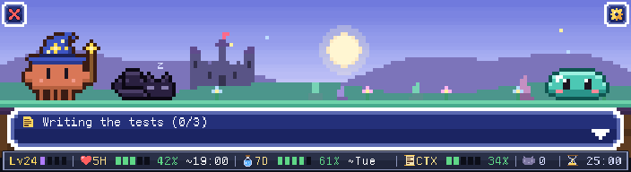
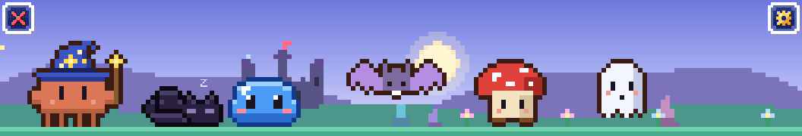
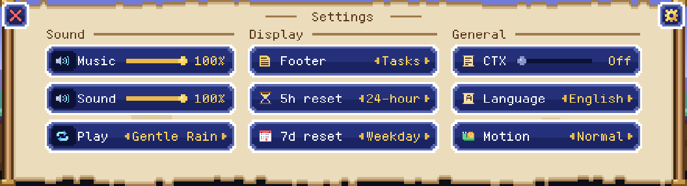

# Pixmage

[中文](README.md) | **English**

> **Fan-made, unofficial and non-commercial.** Pixmage is not affiliated with, endorsed by or sponsored by Anthropic. Clawd is Anthropic's character; this is a fan work made out of affection. If the rights holder asks, we will take it down at once: please open an issue.



A little pixel world above the Claude Code prompt. Every tool call brings a monster: when the call succeeds, Clawd the wizard casts the matching spell and defeats it; when a permission is refused, Clawd raises a honeycomb ward. Defeated monsters give XP and levels, and every conversation on the same computer shares one save. A black cat keeps Clawd company: it sleeps nearby, wakes up to work alongside when Claude starts a subagent, and pounces when the subagent finishes.

## Install

Made for the Code tab of the Claude desktop app.

Sound and music play on **macOS** only: Claude Code has no audio player on Windows or Linux. Everything else works there.

```bash
git clone https://github.com/Nao9494/pixmage ~/.claude/skills/pixmage
```

Open a new conversation and type `/pixmage`.

## How it works

### Monsters

Each tool Claude uses brings its own monster, and Clawd answers each with a different spell:



| Monster | What Claude is doing | Clawd's spell | XP |
|---|---|---|---|
| Slime (green, blue, teal or pink) | Running a command, or any other tool | Fireball | 1 |
| Bat | Reading files, searching code | Lightning | 1 |
| Mushroom | Editing or writing files | Frost | 1 |
| Ghost | Searching the web, external tools (MCP) | Holy light | 2 |

- **A tool fails**: the monster runs away, and no XP.
- **A permission is refused**: Clawd raises a honeycomb ward.
- **Levels**: level N needs N × 5 XP to go up. Levelling up has its own sound and sparkle.
- **Subagents** bring no monster. The black cat wakes up to work alongside, pounces when the subagent finishes, and a success is worth 5 XP.
- **One save** is shared by every conversation on the computer.

### Clawd's looks and moves

- **The hat** follows the model: a cloth cap for Haiku, a blue hat for Sonnet, a purple hat for Opus, a crown for Fable.
- **The wand** follows the thinking effort, five kinds from low to max; the max one glows.
- **A new conversation**: Clawd stretches.
- **You send a message**: Clawd unrolls a scroll to read it.
- **Waiting for your permission**: a "!" pops up over Clawd, so you know a decision is waiting.
- **Compacting**: Clawd packs things into a box.
- **When idle**, Clawd takes turns reading, teasing the cat with the wand, drinking tea, letting the cat rub against him, practising magic and playing with a fairy, then naps with the cat.
- **Click things**: Clawd, the cat and the castle each react.

### The message row

It has two modes, switched on the settings page:
- **To-do** (default): the item Claude is working on, such as "Writing the tests (1/3)".
- **Scribe**: at the end of each turn, Haiku sums up the progress in one line. This uses a little of your usage.

### The status bar

- Level and XP.
- 5-hour and 7-day usage, with their reset times. Click a reset time to change its format.
- CTX: how full this conversation is.
- The number by the cat: subagents running.
- Hourglass: click to start a 25-minute focus timer, click again to stop. It rings when time is up.

If you use Claude through LiteLLM, 5H and 7D become this month's budget (MON) and today's spend (TODAY). Click MON to show a percent, spent/max, or the amount left; click TODAY to show today's spend, a per-day allowance, or the reset date.

### Settings (the gear, top right)



- Music and sound volume; the speaker key mutes.
- Music: the left key switches between repeat-one and shuffle; click the title for the next track.
- The message row mode, and the 5H and 7D time formats (MON and TODAY in LiteLLM mode).
- Auto-compact: runs `/compact` for you when the conversation reaches the level you set. Off by default.
- Language: 中文, English, 日本語.
- Display: power saving, standard, smooth.

### Commands

- `/pixmage`, `/pixmage off`: show or hide the picture.
- `/pixmage sound on|off`: sound effects.
- `/pixmage clock 24|12|left`: the 5H reset time format.
- `/pixmage compact on|off`: run `/compact` automatically at 80% full. For another level, use the slider on the settings page.

## Your own music

Put MP3 files in `music/`. Shorter titles go in `music/titles.json`.

## Licences and credits

- **Code**: MIT (`LICENSE`).
- **Font**: Fusion Pixel Font, SIL OFL 1.1 (`fonts/`).
- **Sound effects**: synthesized, plus CC0 effects by Juhani Junkala (`sounds/CREDITS.txt`).
- **Music**: six CC0 tracks by Holizna (`music/CREDITS.txt`).
- **Clawd**: Anthropic's character; see the note at the top.
