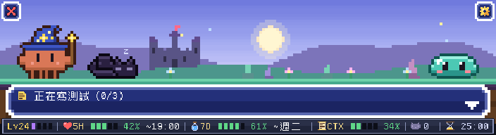
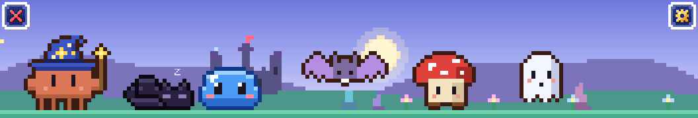
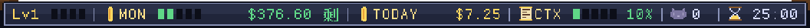
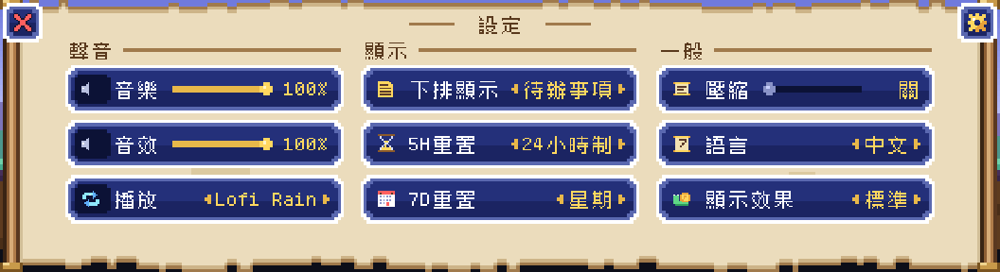

# Pixmage（像素法師）

**中文** | [English](README.en.md)

> **粉絲自製、非官方、非營利。** Pixmage 與 Anthropic 沒有任何關係，也沒有得到 Anthropic 的認可或贊助。Clawd 是 Anthropic 的角色，這裡只是出於喜愛做的同人作品。如果權利人希望下架，請開 issue 通知，我們會立即移除。



在 Claude Code 輸入框上方的像素小世界。Claude 每呼叫一次工具，就有一隻怪物出現：呼叫成功，小法師 Clawd 就用對應的魔法打倒牠；權限被拒絕時，Clawd 會升起蜂巢結界。打倒怪物可以得到經驗值、升級，同一台電腦上的所有對話共用一份存檔。黑貓負責陪 Clawd：平常在旁邊睡覺，Claude 叫出子代理時醒來陪著工作，子代理完成時撲上去。

## 安裝

需要 Claude 桌面 App 的 Code 分頁。畫面是為桌面 App 設計的。

音效和背景音樂只在 **Mac** 上有聲音：Claude Code 在 Windows 和 Linux 上沒有播放器，畫面和其他功能照常。

```bash
git clone https://github.com/Nao9494/pixmage ~/.claude/skills/pixmage
```

開一個新對話，打 `/pixmage`。

## 怎麼玩

### 怪物圖鑑

Claude 用什麼工具，就出現什麼怪物。Clawd 會用不同的魔法對付牠們：



| 怪物 | Claude 在做什麼 | Clawd 的魔法 | 經驗值 |
|---|---|---|---|
| 史萊姆（綠、藍、青、粉紅四種） | 跑指令，或其他工具 | 火球 | 1 |
| 蝙蝠 | 讀檔案、搜尋程式碼 | 閃電 | 1 |
| 香菇 | 修改、寫入檔案 | 冰霜 | 1 |
| 幽靈 | 上網查資料、用外部工具（MCP） | 聖光 | 2 |

- **工具失敗**：怪物會逃走，沒有經驗值。
- **權限被拒絕**：Clawd 升起蜂巢結界。
- **升級**：第 N 級要 N × 5 點經驗值才能升下一級。升級時有音效和特效。
- **子代理**：不會出怪物。黑貓會醒來陪 Claude 工作，子代理完成時撲上去，成功一次加 5 點經驗值。
- **存檔**：同一台電腦上的所有對話共用一份存檔。

### Clawd 的樣子和動作

- **帽子**跟著模型換：Haiku 是布帽，Sonnet 是藍帽，Opus 是紫帽，Fable 是王冠。
- **魔杖**跟著思考強度換：從低到最大共五種，最大是會發光的傳說法杖。
- **開新對話**：Clawd 伸個懶腰。
- **你送出訊息**：Clawd 打開卷軸讀你的訊息。
- **等你按允許**：Clawd 頭上冒出「！」，提醒你有事要決定。
- **壓縮對話時**：Clawd 把東西打包進箱子。
- **閒著的時候**：Clawd 會輪流看書、用魔杖逗貓、喝茶、讓貓蹭蹭、練習魔法、跟小精靈玩，最後跟貓一起睡午覺。
- **點畫面上的東西**：點 Clawd、黑貓或城堡，各有小反應。

### 下方訊息欄

有兩種模式，在設定頁切換：
- **待辦事項**（預設）：顯示 Claude 正在做的那一項，例如「正在寫測試（1/3）」。
- **書記官**：每回合結束時，用 Haiku 濃縮一句目前進度。這會用到一點點額度。

### 最下面的狀態列

- 等級和經驗值。
- 5 小時和 7 天的用量，以及重置時間。點重置時間可以換顯示格式。
- CTX：這個對話塞滿了幾成。
- 黑貓旁邊的數字：正在跑的子代理數量。
- 沙漏：點一下開始 25 分鐘的專注倒數，再點一下停止。時間到會響。

透過 LiteLLM 使用的人，5H 和 7D 會換成本月預算（MON）和今天的花費（TODAY）。點 MON 可以換成百分比、已花/上限或剩餘金額；點 TODAY 可以換成今日花費、每天可花或重置日。



### 設定頁（右上角齒輪）



- 音樂和音效的音量，旁邊的喇叭鍵可以靜音。
- 選歌：左邊的鍵切換單曲循環或隨機播放，點歌名換下一首。
- 下方訊息欄的模式、5H 和 7D 的時間格式（LiteLLM 模式下是 MON 和 TODAY 的顯示方式）。
- 自動壓縮：對話塞到設定的比例時，自動幫你執行 `/compact`。預設關閉。
- 語言：中文、English、日本語。
- 顯示效果：省電、標準、流暢。

### 指令

- `/pixmage`、`/pixmage off`：打開或關掉畫面。
- `/pixmage sound on|off`：音效開關。
- `/pixmage clock 24|12|left`：5H 重置時間的格式。
- `/pixmage compact on|off`：對話塞到 80% 時自動執行 `/compact`。想要別的比例，到設定頁拉。

## 自己的音樂

把 MP3 放進 `music/` 資料夾就會播。想要短一點的歌名，可以寫在 `music/titles.json`。

## 授權與來源

- **程式碼**：MIT（`LICENSE`）。
- **字型**：Fusion Pixel Font，SIL OFL 1.1（`fonts/`）。
- **音效**：自行合成，加上 Juhani Junkala 的 CC0 音效（`sounds/CREDITS.txt`）。
- **音樂**：Holizna 的 6 首曲子，CC0（`music/CREDITS.txt`）。
- **Clawd**：Anthropic 的角色，見最上方的聲明。
